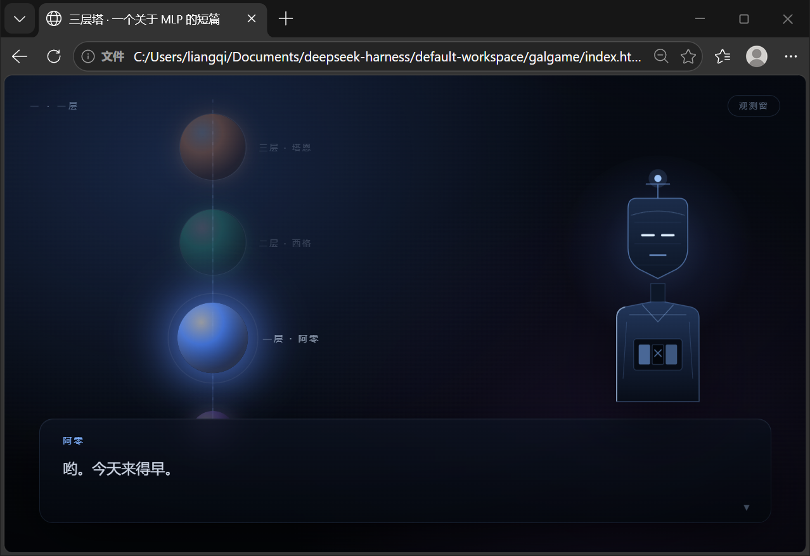

# 三层塔



一个用 galgame 形式讲清楚 MLP（多层感知机）的短篇网页游戏。

双击 `index.html` 就能玩，不需要安装任何东西，也没有构建步骤。

## 它讲的是什么

塔有三层，住着三个角色。每天傍晚，有人站在塔下说一句话，塔把这句话一层一层往上送，再把一个回答送下来。

- **一层 · 阿零（ReLU）**：只放正数过去。算出来是负的，门就关上，从里面打不开。
- **二层 · 西格（Sigmoid）**：把所有数都摁进 0 到 1 之间。多大的事，到她这儿都只剩一点点。
- **三层 · 塔恩（tanh）**：只看最后那个数，说「挺好的」或者「不太好」。

一句话往上走，是前向传播；答案是错的，就要顺着来路往回找，是反向传播。三个结局对应三种真实的训练失败：死神经元、梯度为零、学习率过大。

## 这不是课件

塔里跑的是一个真的 2-3-2-1 网络，权重随机初始化后固定种子，每一次前向、每一步梯度下降都在浏览器里真算。

右上角的「观测窗」显示的就是这些真实数字：每一层的 z 和 a、当前的 loss、以及 loss 随 epoch 下降的曲线。三条结局路线用同一套代码跑出来，数值分别是 0.043、0.043、0.011。

其中两条路的 loss 一模一样，但内部表征不同——这是一个关于「loss 不测量理解」的小把戏。

## 结构

```
index.html   页面骨架
style.css    全部样式
mlp.js       2-3-2-1 网络：前向、反向、SGD（UMD，可在 Node 里单独跑）
viz.js       观测窗里的网络图与 loss 曲线（手写 SVG）
sprites.js   三个角色的立绘（手写 SVG，随说话人切换）
engine.js    轻量 VN 引擎：打字机、队列化演出、选择支、训练动画
story.js     剧本
```

没有依赖，没有打包。想改剧本只动 `story.js`，想改画风只动 `style.css` 和 `sprites.js`。

## 怎么玩

点击或空格推进。四个选择点分别在开头、中段和结尾：先听谁说话、敲不敲那扇门、今天怎么样、要怎么改这座塔。

一局大约 8 分钟。

## 许可

MIT
